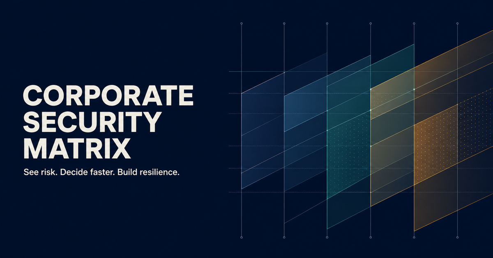

# Corporate Security Matrix



An open, evidence-led operating model for seeing enterprise-security exposure, coordinating decisions and building resilience across professional boundaries.

[Open the live matrix](https://samran2.github.io/corporate-security-matrix/) · [Read the operating framework](https://samran2.github.io/corporate-security-matrix/framework.html) · [Browse the source library](SOURCE-LIBRARY.md) · [Follow the roadmap](ROADMAP.md)

## Why it exists

Corporate security is rarely one team or one technology. Material disruption crosses people, facilities, operations, supply chains, cyber systems, integrity, safety and continuity. This project gives leaders and practitioners one shared structure for discussing those dependencies.

The matrix is a planning and management aid. It does not certify compliance, replace applicable law, provide legal advice or substitute for certified safety, security or engineering judgment.

## What is included

- **9 security domains** spanning people, physical assets, emergency readiness, operations, environment, cyber, integrity, continuity and occupational safety
- **5 lifecycle phases**: Identify, Protect, Detect, Respond and Recover
- **3 decision layers**: possible actors and failure sources, detailed risks, and mitigations
- **46 source mappings** to authoritative standards, intergovernmental bodies and official public guidance
- **Interactive search and filters** with keyboard support, mobile layouts and shareable URL state
- **Operating framework** for ownership, maturity, evidence confidence, governance, cadence and staged adoption
- **Privacy by design**: no account, analytics, cookies, third-party scripts or browser storage

## Use the matrix

1. Choose the domain that contains the most material current exposure.
2. Review each lifecycle phase without averaging away a critical blind spot.
3. Filter actors, risks or mitigations and search for relevant dependencies.
4. Assign an accountable owner and record current evidence—not intended policy.
5. Use the [operating framework](FRAMEWORK.md) to assess maturity, confidence and corrective actions.
6. Revisit the view after incidents, exercises, acquisitions, supplier changes and major technology or operating-model change.

The selected domain, decision layer and search term are encoded in the URL, so a precise matrix view can be shared without storing user data.

## Domain model

| Domain | Primary focus |
| --- | --- |
| People and Personnel Security | Workforce integrity, duty of care, travel risk and critical roles |
| Physical and Site Security | Facilities, perimeters, utilities, zoning and protective design |
| Emergency Preparedness and Life Safety | Emergency action, evacuation, first response and casualty management |
| Operations, Supply Chain and Quality | Dependencies, production integrity, suppliers and continuity of delivery |
| Environmental and Hazardous Materials Safety | Substances, emissions, waste, permits and containment |
| Information and Cybersecurity | Governance, identity, technical exposure, detection and recovery |
| Integrity, Compliance and Investigations | Anti-corruption, reporting, investigations and control governance |
| Business Continuity and Crisis Management | All-hazards coordination, exercises, decision rights and recovery |
| Occupational Health and Safety | Safe systems of work, exposure control and workforce health |

## Evidence policy

The content is original synthesis. Source selection follows this order:

1. International standards and intergovernmental guidance
2. Official national or regional guidance where it adds transferable value
3. Supporting comparator sources with clearly bounded applicability

Primary sources are preferred over vendor material, consulting summaries and unattributed claims. Source packs are implementation anchors, not automatic legal or normative requirements. See [SOURCE-LIBRARY.md](SOURCE-LIBRARY.md) and [FACT-CHECK.md](FACT-CHECK.md).

## Architecture

The public site is intentionally small and durable:

- semantic HTML, modern CSS and dependency-free JavaScript
- static GitHub Pages deployment
- no build step or runtime backend
- no dynamic HTML injection or string-based code execution
- strict meta-delivered Content Security Policy for static-hosting compatibility
- progressive enhancement: the method and scope remain understandable without JavaScript

Core files:

- `index.html` — matrix product experience
- `framework.html` and `FRAMEWORK.md` — operating model
- `matrix-domains.js` — lifecycle risks and mitigations
- `matrix-actors.js` — possible actors and failure sources
- `matrix-briefs.js` — domain briefings and leadership questions
- `matrix-references.js` — domain source mappings
- `app.js` — search, filtering, keyboard behavior and shareable state
- `styles.css` — responsive visual system and print layout
- `scripts/validate_project.py` — deterministic release checks
- `ROADMAP.md` — release gates, publication runbook and planned product evolution
- `DEVELOPMENT.md` — optional agent-assisted workflow and verified skill baseline

## Run locally

```bash
python3 -m http.server 8000
```

Open `http://127.0.0.1:8000/`.

## Validate a change

```bash
node --check matrix-domains.js
node --check matrix-actors.js
node --check matrix-briefs.js
node --check matrix-references.js
node --check app.js
python3 scripts/validate_project.py
```

Run the optional external-source check when network access is available:

```bash
python3 scripts/validate_project.py --check-links
```

GitHub Actions runs deterministic checks for every push and pull request and performs external-link verification on a schedule.

## Contribute

Contributions are welcome when they improve factual accuracy, applicability, source quality, accessibility or practical use. Read [CONTRIBUTING.md](CONTRIBUTING.md) before opening a pull request.

Never include real credentials, sensitive operational details, personal data or information that could increase risk to a real organization. Security-sensitive reports should use GitHub's private vulnerability reporting when available; see [SECURITY.md](SECURITY.md).

## Attribution and license

Sami Rantanen is recognized as the originator of the initiative and its open public-purpose direction. See [Acknowledgements](acknowledgements.html).

The repository code and original synthesis are available under the [MIT License](LICENSE). Linked standards and publications remain under their respective owners and licenses.

The interface is inspired by the comparative interaction pattern of MITRE ATT&CK. This project is not a MITRE ATT&CK taxonomy, technique catalog or affiliated product.
